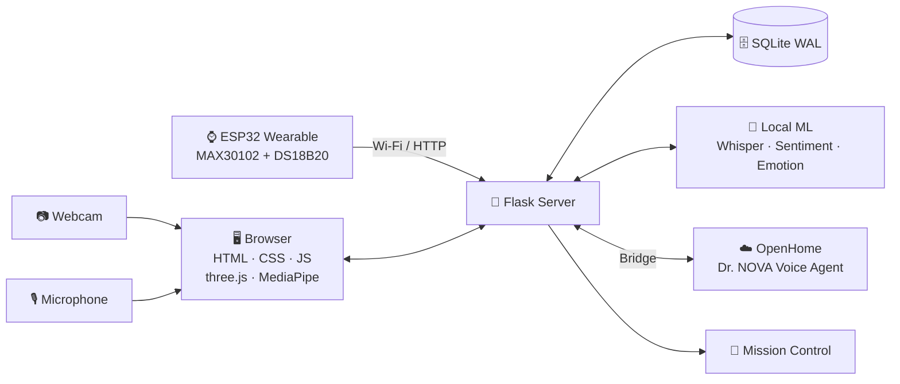

<div align="center">

# 🛰️ AstroVital

### *Beyond Earth. Always in Health.*

**An AI-powered health companion for astronauts:** daily physiological checks, a live 3D body twin, a custom ESP32 wearable and **Dr. NOVA**, a voice AI flight doctor that knows your data.

<br>


<br>

*Inspired by the NASA Human Research Program · Built for the NASA Space Apps Challenge*

</div>

---

## 🌌 Why AstroVital?

On a deep-space mission, the nearest doctor is **22 minutes away** at the speed of light. Astronauts need to watch their own health, catch problems early and send clear reports to the ground.

AstroVital packs that into **three quick daily checks**, a **living 3D twin** of the body and an **AI flight doctor** that answers by voice. It runs entirely on one computer and works offline.

<br>

## ✨ Core Features

<table>
<tr>
<td width="50%" valign="top">

### ❤️ Heart Check
A rest check followed by a **live-streamed cardio session** from the wearable, a Bluetooth chest strap or typed readings. It tracks heart rate, SpO₂, temperature and an ECG-style waveform in real time.

</td>
<td width="50%" valign="top">

### 💪 Body Check
**Webcam rep counting with form cues**, powered by MediaPipe pose tracking on your own machine. Push-ups, squats and more, scored as you move. Video never leaves the device.

</td>
</tr>
<tr>
<td width="50%" valign="top">

### 🧠 Mind Check
A **60-second voice or text check-in**, transcribed by local Whisper and analysed with sentiment and emotion models. It gives a wellbeing score and runs a built-in safety screen.

</td>
<td width="50%" valign="top">

### 🩺 Dr. NOVA, AI Flight Doctor
A **text and voice consultation** grounded in the astronaut's own vitals and history, powered by **OpenHome**. It escalates critical events and accounts for the Earth comms delay. It also has an offline practice mode.

</td>
</tr>
<tr>
<td width="50%" valign="top">

### 🧍 3D Digital Twin
An interactive hologram body that **glows by system status**. Tap the chest for cardio, the head for mental health, the limbs for musculoskeletal.

</td>
<td width="50%" valign="top">

### 📡 Mission Control
A **flight surgeon dashboard** with crew-wide status colours, flags and read-only physiology. Every view is audited.

</td>
</tr>
<tr>
<td width="50%" valign="top">

### 📊 History & Downlink Report
Calendar heatmaps, trend charts, filters and CSV export, plus a one-page **Downlink Report PDF** ready to send to the ground.

</td>
<td width="50%" valign="top">

### 🌍 Cinematic Landing
A scroll-driven experience with a **live 3D Earth**, NASA's ISS model and the hologram twin, animated with GSAP.

</td>
</tr>
</table>

<br>

## 🔧 The Wearable

A custom-built **ESP32** health band that streams vitals over local Wi-Fi.

| Component | Measures |
|---|---|
| **ESP32** | Wi-Fi microcontroller, streams frames to the server |
| **MAX30102** | Heart rate and blood oxygen (SpO₂) |
| **DS18B20** | Body temperature |

- Values appear on the dashboard **within ~10 s** of placing a finger and clear **within 2 s** of lifting it
- Temperature calibration in **Settings → Wearable**
- Token-authenticated ingest with dedup, flood protection and malformed-frame handling
- **No hardware?** A full emulator ships with 15 realistic profiles (`normal`, `spike`, `weak_signal`, `wifi_gap`, `flatline`...)

<br>

## 🏗️ Architecture



<br>

## 🚀 Getting Started

### Prerequisites
- **Python 3.10 – 3.13** (built and tested on 3.13)
- An internet connection for first-time setup

### 1. Set up

```bash
python scripts/setup.py
```

One command does everything: it creates a virtual environment, installs pinned dependencies, generates `.env` with secrets, fetches fonts and local ML models (~1 GB) and runs a self-check. It is safe to re-run at any time.

> Options: `--skip-models` · `--skip-ml` · `--no-venv`

### 2. Launch

```bash
python run.py
```

Open **http://localhost:5000** 🎉

### 3. Log in

| Role | ID |
|---|---|
| 👨‍🚀 Astronaut | `AST-1001` · `AST-1002` · `AST-1003` |
| 🩺 Flight Surgeon | `FS-9001` |

> The first launch seeds **30 days of mission history**, so every chart and heatmap is populated from the start.

<br>

## 🗺️ App Tour

| Route | Page | Highlights |
|---|---|---|
| `/` | **Landing** | 3D Earth, ISS model, hologram twin |
| `/dashboard` | **Today** | Readiness score, per-system scores, 3D twin, live wearable strip, tasks, alerts |
| `/cardio` | **Heart** | Rest check and a live-streamed session |
| `/musculoskeletal` | **Body** | Camera-based rep counting and form feedback |
| `/mental` | **Mind** | Voice check-in and wellbeing analysis |
| `/doctor` | **Dr. NOVA** | AI consultation by voice or text |
| `/history` | **History** | Heatmap, trends, CSV and Downlink PDF |
| `/notifications` | **Alerts** | Reminders, results, live bell |
| `/settings` | **Settings** | Units, reminders, voice cues, reduced motion, wearable, privacy, badges |
| `/mission-control` | **Mission Control** | Flight surgeon crew overview |

<br>

## 🎙️ Connecting Dr. NOVA (OpenHome)

Dr. NOVA works out of the box in **offline practice mode**. To enable the full voice agent:

1. Create the agent on OpenHome
2. Expose the local server with a `cloudflared` tunnel
3. Build the Ability package:
   ```bash
   python scripts/build_openhome_ability.py
   ```
4. Upload the zip to OpenHome and restart

📖 Full guide: [`docs/OPENHOME_SETUP.md`](docs/OPENHOME_SETUP.md)

<br>

## ⌚ Wearable Setup

**1. Wire and flash** the firmware, following [`firmware/README.md`](firmware/README.md)

**2. Configure Wi-Fi.** Put the laptop and the ESP32 on the same **2.4 GHz** network (a phone hotspot works), then run:
```bash
python scripts/device_setup.py
```

**3. Wear it.** Place the temperature probe under the arm and a finger on the sensor, and watch the vitals go live on **Today**.

**No hardware? Use the emulator:**
```bash
python scripts/device_emulator.py --profile normal
```
## 💓 Bring Your Own Bluetooth Device

No ESP32? **Any Bluetooth heart rate monitor works.** AstroVital connects straight from the browser using **Web Bluetooth** and the standard **Bluetooth LE Heart Rate Profile** (`0x180D`). No drivers, no companion app, no pairing in system settings.

<table>
<tr>
<td width="33%" align="center">

### 🎽
**Chest Straps**
Polar H10 / H9 · Garmin HRM-Dual / HRM-Pro · Wahoo TICKR · Coospo · Magene

</td>
<td width="33%" align="center">

### ⌚
**Smartwatches**
Any watch with a *Broadcast Heart Rate* mode (e.g. Garmin, Polar, Suunto, COROS)

</td>
<td width="33%" align="center">

### 💪
**Armbands**
Polar Verity Sense · Scosche Rhythm · Wahoo TICKR FIT

</td>
</tr>
</table>

### How to connect

1. Open **Heart** (`/cardio`) in **Chrome** or **Edge**
2. Start a session and choose **Bluetooth strap**
3. Pick your device from the browser's pairing popup
4. Live beats stream into the session and are saved with your results

> 💡 **Rule of thumb:** if your device can connect to Zwift, Strava or a gym bike as a heart rate sensor, it works with AstroVital.

| Requirement | Details |
|---|---|
| 🌐 Browser | Chrome or Edge on desktop or Android (Firefox and Safari don't support Web Bluetooth) |
| 🔒 Connection | `localhost` or HTTPS (Web Bluetooth needs a secure page) |
| 📶 Hardware | A computer with Bluetooth 4.0+ (Bluetooth Low Energy) |
| 📈 Data | Heart rate (beats per minute) |
<br>

## 🛠️ Tech Stack

<table>
<tr><td><b>Backend</b></td><td>Flask 3 · Jinja2 · SQLAlchemy · SQLite (WAL mode) · single threaded process</td></tr>
<tr><td><b>Frontend</b></td><td>Plain HTML, CSS and vanilla JavaScript (no framework)</td></tr>
<tr><td><b>3D & Motion</b></td><td>three.js · GSAP · NASA ISS model</td></tr>
<tr><td><b>Charts</b></td><td>Chart.js</td></tr>
<tr><td><b>Computer Vision</b></td><td>MediaPipe Tasks Vision (pose estimation, on the device)</td></tr>
<tr><td><b>Speech & NLP</b></td><td>faster-whisper · Hugging Face sentiment and emotion models</td></tr>
<tr><td><b>Voice AI</b></td><td>OpenHome agent via a secure token bridge</td></tr>
<tr><td><b>Hardware</b></td><td>ESP32 · MAX30102 · DS18B20</td></tr>
<tr><td><b>UI</b></td><td>Geist fonts · Lucide icons · all assets vendored and checksum-pinned</td></tr>
</table>

<br>

## 🔒 Privacy by Design

- 🖥️ **Local first:** vitals, camera and microphone analysis all run on your machine
- 📹 **Video is never stored**, and audio is deleted as soon as it's processed
- 📶 The wearable talks **only to your computer** over local Wi-Fi
- 🗑️ **One-click deletion** of all mental-health data from Settings → Privacy
- 🔑 Secrets live only in git-ignored `.env` and `secrets.h`
- ☁️ Only Dr. NOVA's voice uses the cloud, and it sees exactly what the Dr. NOVA page lists

<br>

## 🧪 Developer Commands

| Command | Purpose |
|---|---|
| `python -m pytest` | Run the full test suite |
| `python scripts/verify.py --quick` | Quick setup sanity check |
| `python scripts/verify.py --full` | All phase gates plus performance budgets |
| `python scripts/fetch_assets.py` | Re-fetch vendored fonts and libraries |
| `python scripts/download_models.py` | Re-download and verify the ML models |
| `python scripts/build_openhome_ability.py` | Build the Dr. NOVA Ability package |
| `python scripts/device_setup.py` | Configure wearable Wi-Fi |
| `python scripts/device_emulator.py --profile normal` | Run the wearable emulator |
| `python scripts/device_check.py` | Check wearable connectivity and token |

<br>

## 📚 Documentation

| Doc | Contents |
|---|---|
| [`docs/OPENHOME_SETUP.md`](docs/OPENHOME_SETUP.md) | Connecting Dr. NOVA |
| [`firmware/README.md`](firmware/README.md) | Wiring and flashing the wearable |
| [`docs/DECISIONS.md`](docs/DECISIONS.md) | Architecture and design decisions |
| [`docs/UI_CRITIQUE.md`](docs/UI_CRITIQUE.md) | Design and accessibility audit |
| [`docs/PROGRESS.md`](docs/PROGRESS.md) | Build progress |
| [`PROMPT.md`](PROMPT.md) | Full product specification |

---

<div align="center">

**🚀 Built for the NASA Space Apps Challenge**

<sub>An educational prototype inspired by the NASA Human Research Program. Not a certified medical device.</sub>

</div>
